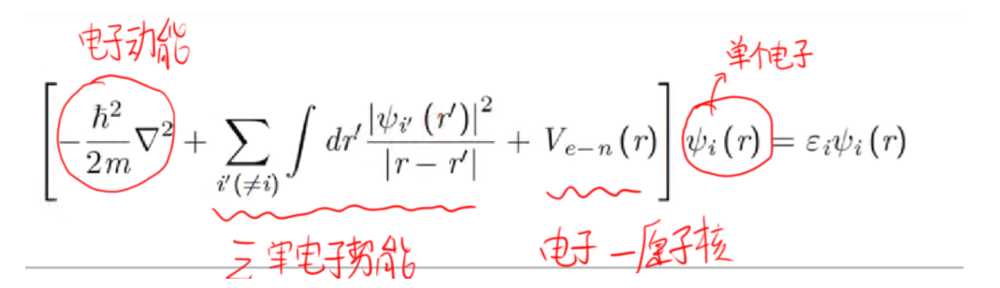
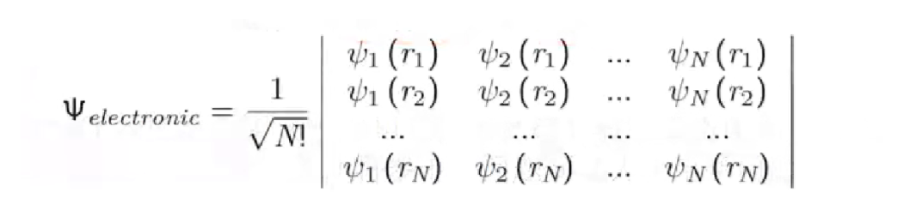
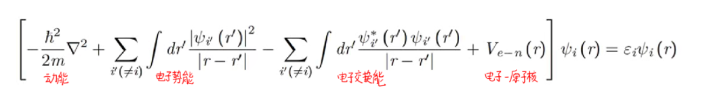
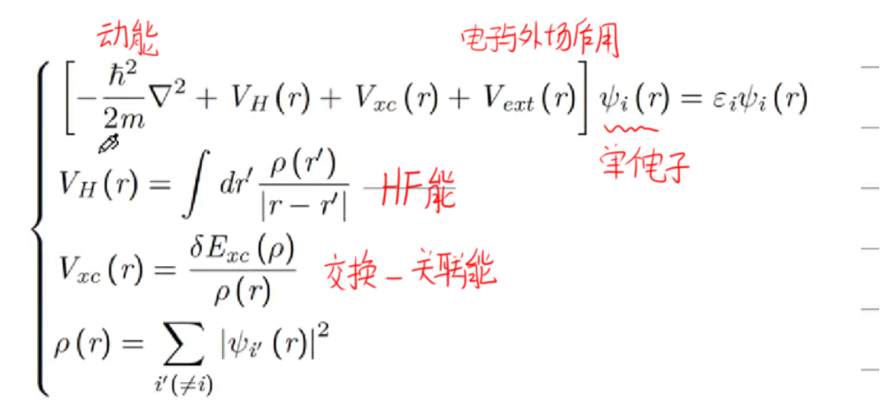
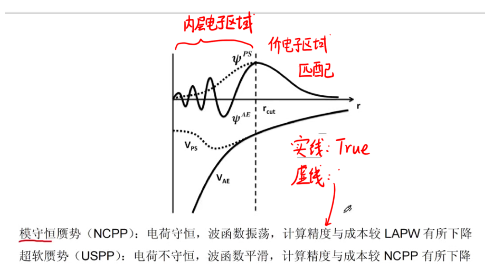
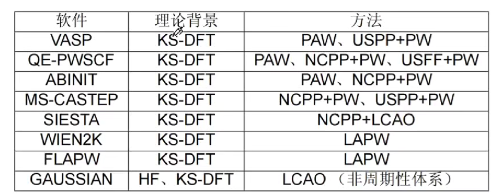
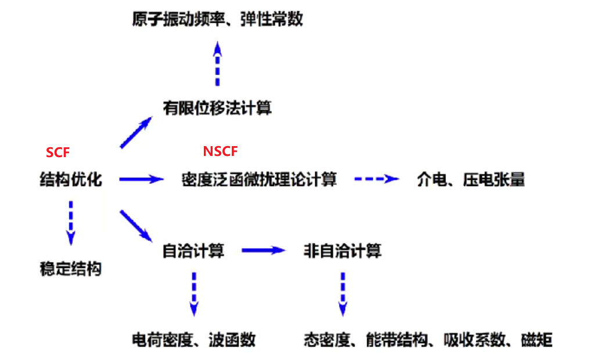
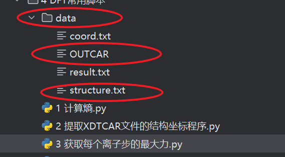
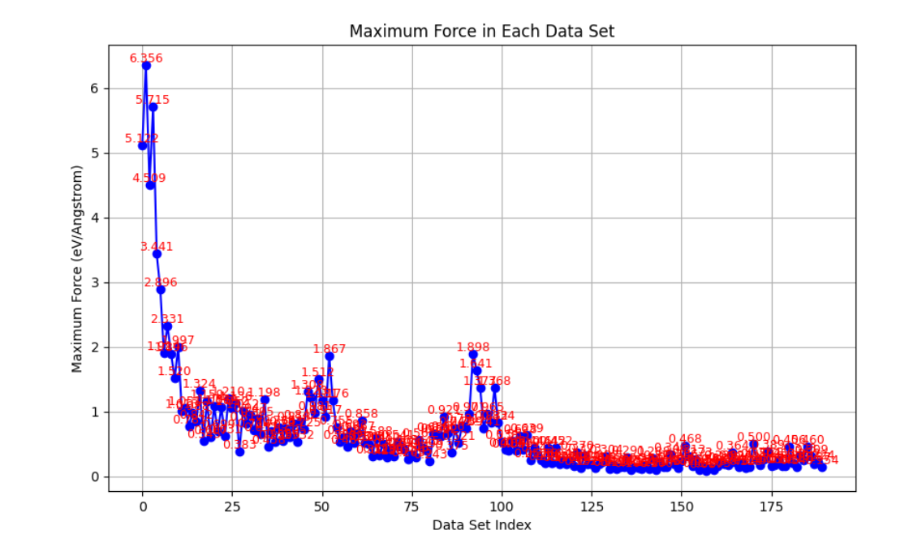

### 1. 前言

​	笔者并不是材料计算专业的，对于量子力学、量子化学、甚至材料方向的内容知道并不多。因此理解有误、笔误的地方请谅解，也可以写在评论区帮助大家避雷。

​	虽然并不这个方向的，但是一些必备的基础知识，还是可以了解，这样可以知道后期软件为何需要这些参数，为何运行结果是这样的。

​	已经完成的文章：

- [DFT教程 part1 VASP安装与学习推荐](https://blog.csdn.net/weixin_46676835/article/details/151904756?spm=1001.2014.3001.5501)

> 大家转载的时候，请附上原文链接，编写不易，尊重原创，谢谢！！
>
> 目录

[TOC]

### 2. 整理理论框架

> 之所以还是谈这个，是因为知道这个框架在干什么，与知道这个框架是什么成分构成的，还是不同的。我们的目的就是知道这个框架是干什么的，这样后续计算如果遇到一些疑问，或许可以得到解答。

#### 2.1 薛定谔方程

​	具体的知识我们不讲，只说一下关键的点，可能有帮助的地方。

​	方程形式：


​	其中：

- H称为哈密顿量，包含了各种相互作用（电子动能、原子核动能、电子-核相互作用、电子-电子相互作用、核-核相互作用
- Ψ称为波函数，与位置、时间相关

​	而，关于波函数，需要进一步了解一下，波函数的平方模∣ψ(x,t)∣2表示粒子在位置 x和时间 t 出现的概率密度，即其满足：


   **波函数本身不能直接观测到**，观测到的是波函数的平方模（概率密度）或其相关的物理量（如动量、能量等）。波函数包含了系统所有的量子信息，可以用来计算任何可观测量的期望值。

​	既然存在方程，我们肯定希望能够求解出来，这样关于原子的任何性质都在我们的掌握之中，但是薛定谔方程的直接求解非常困难，也不现实，因此需要进一步简化。

#### 2.2 方程简化

1. 第一个简化：我们的研究状态是稳态，即与时间无关，这样直接减少一个变量
2. 第二个简化：Born-Oppenheimer近似（波恩-奥本海默近似）

​	这个近似的核心内容：**电子被原子核束缚住。**可以这么理解，电子在疯狂运动，但是原子核其实基本没怎么动，因此可以把原子核和电子分开考虑。

3. 第三个简化：Hartree近似

​	这个近似的核心内容：**将多电子体系，近似为多个单电子体系**。即，单个电子受到其他电子的作用力，等效为单个电子受到其他电子产生的平均势场的作用，体现为：


​	将这些简化代入到我们的薛定谔方程，具体的简化过程我也不了解，总之得到了**Hartree简化形式的薛定谔方程：（这个方程很重要，是后面的基础）**



4. 第四个简化：费米子简化

​	我们知道电子是一种费米子，其波函数必须满足反对称原则，即：

- **反对称：**任意两个电子交换位置，波函数加一个负号即可完成
- **费米子：**自旋量子数，由原本的±1，变为±1/2满足

​	这两个条件，把波函数可以书写为（公式推导略）：

​	**说明**：行列式任意两行/列交换位置，加一个负号即可。

#### 2.3 Hartree-Fock方程

​	经过上述的简化，我们就可以得到我们的HF方程了，也是古老的DFT理论基础核心方程：



​	并且引入了我们一个关键的能量：交换能。**之所以称之为交换能，是因为多出的这项，是我们为了体现电子的反对称性才引入的，而反对称性就是互换的体现，因此称之为交换能。**

​	但是：

1. **之所以引入交换能，是防止电子重叠问题**：因为我们在考虑的时候，并没有考虑电子本身体积，导致电子可以无限制重叠。此时，我们想一想，如果两个电子交换位置，波函数的值为0，这种情况是不存在的，即两个电子的位置相同是不被允许的。
2. **而HF方程，只优化了自旋方向相同的平行电子**，即如果两行或者两列完全相同，那么交换位置，计算出的波函数为0，这是不存在的，因此修正了重叠问题。

3. 这就是它的问题所在：**没有修正自旋方向相反的平行电子**。这也是后面需要修正的一项。

#### 2.4 Hohenberg-Kohn定理

​	DFT理论基于这个定理才得以构建。

1. 多电子系统的基态能量是电荷密度的唯一泛函
2. 在电子总数保持不变的情况下，总能关于电荷密度泛函的极小值就是系统基态的能量，对应的电荷密度就是基态电荷密度

​	==> 解释：

- **泛函**：y = f(x) 是一个基础函数，如果 f本身也是一个函数，那么就称之为泛函
- 唯一泛函：即基态能量与电荷密度是一一对应的，虽然还不知道f的具体形式，但是形式是唯一的

​	**知道这个还不行，还得去想如何求解基态能量与基态电荷密度**。第二条就告诉我们，泛函的极小值就是基态能量，它对应的电荷密度（第一条知道是一一对应的）就是基态电荷密度。

#### 2.5 密度泛函理论

   对于给定的外部势场，能量由三部分构成：电子动能、电子相互作用、外部势能：（**这一点和HF基本一致**）


​	而现在的密度泛函基本都是KS-DFT，即**它采用了HF方程和交换能，再引入关联能来进一步修正**。

> 注意：交换能也没有完全照搬，只是做了近似操作，为了减少计算量。比如，我们知道的杂化泛函：采取25%HF交换+75%KS-DFT交换。

​	具体的形式：



​	其中，关键的就是交换-关联能，因为这个是近似处理，所以一般优化这里，目前常见的两种形式：

1. 局域密度近似 - LDA：假设电荷密度随空间坐标缓慢变化，将空间网格化、离散化，这样小网格里面视为常数。**存在的问题**：比如离子键，本身是偏向某个原子，这样做就是偏向共价化，而共价键又短，所以会导致晶格常数偏小。

2. 广义梯度近似 - GGA：引入一个梯度项，更接近真实，现在一般都是采用GGA，一般都是实验为主，计算为辅助，作为一个定性的说明。

   **发展方向**：就像对于一个值的泰勒展开，项越来越多，越来越接近真实值，不过这也代表计算量越来越大。

#### 2.6 计算方法

​	上面都是理论的讲解。具体到计算，我们需要知道：波函数如何计算。   

​	大规模并行计算，采用多核体系。为了保证计算量和理论本身的基础，**整体波函数 = 把它展开成很多基函数项来计算**。

​	因此，引入基组的概念：在量子化学或DFT计算中，我们不能直接对连续的波函数或密度积分，所以需要将它们展开成一组已知的函数的线性组合，这些函数就组成了一个基组（Basis Set）。

​	常见的基组类型：

- **原子轨道基组（主要用于孤立分子）：**原子上单个电子的轨道叠加起来，电子的轨道信息非常清楚、哪个电子参与成键都很明确，但是对于晶体体系无法准确描述，只适合非周期，适合描述化学轨道、成键电子信息。
- **平面波基组（Plane Waves，主要用于周期性体系）：**任何一个函数都可以用傅里叶级数展开，而傅里叶级数本质上就是正弦波，因此称之为平面波。函数是一个周期性的波函数，适合去描述晶体。如果去算非周期性，问题是要把周期性局限于某一个部分，也是有办法处理的。

​	而具体到如何去计算，主要是处理电子部分，因为对于一个原子来说，电子分为两部分，内层电子（芯电子）和价电子，其中价电子主要与性质相关，因此出现了两种基础处理办法：

- 全电子法：原子核用外部势场描述，**电子用线性缀加平面波函数描述（LAPW）**，芯电子采用球对称原子核势场和球谐、径向波函数，价电子区域采用均匀势场和平面波。全电子就是所有电子都考虑，精度、成本高。
- 赝势法：内层电子多，计算成本高，这样将原子核与部分芯电子合并为一个原子实。波函数包括价电子（有时候和部分芯电子），外部势场包括原子核和全部/部分芯电子

> 赝势分类



> 常见软件的计算方法



### 3. VASP基础知识

#### 3.1 运行流程

​	几乎所有的DFT计算流程都遵循下面的流程：

1. 创建结构，并完成结构优化，称之为SCF计算（自洽计算）
2. 接着在稳定的结构上，进行下一步计算，比如电荷密度、振动频率、能带结构、态密度等等，称之为NSCF计算（非自洽计算）。

​	参考下图：




​	注意：	

- 结构不能随便输入，需要构建出合理的结构；否则会出现：优化的结构不准确 + 报错，优化出错
- 自洽计算：读取之前结构优化的结果，算出电荷密度和波函数
- 非自洽计算：读取之前的结构优化的结果和自洽计算算出的电荷密度和波函数，可以计算出态密度、能带结构等等性质

#### 3.2 VASP的四个输入文件

> INCAR文件

​	输入的参数文件。

​	模板：

```
# 这是注释
key = value
```

​	参数的写法都是：参数名字 = 参数值。

> KPOINTS文件

​	布里渊区的采样点设置。采点设置分为两大类，即gamma点和MP点，这两者本质上没有区别，因为MP点位移0.5即可覆盖gamma点。

​	另外，点的设置分为x、y、z三个轴，因此需要三个数控制，数字越小，运行越快，精度越低。

​	常用的点推荐：

1. 粗跑：gamma点 + 1\*1*1
2. 一般：K点 + 3\*3*3（这个值如何更好更科学的确定，后面会说）

​	模板：

- gamma形式

```
K-Spacing Value to Generate K-Mesh: 0.000
0
Gamma
   1   1   1
0.0  0.0  0.0
```

- MP形式

```
K-Spacing Value to Generate K-Mesh: 0.040
0
Monkhorst-Pack
   1   1   1
0.0  0.0  0.0
```

> POTCAR文件

​	在上一节说过，VASP计算方法是PAW，即平面波方法结合赝势，因此需要赝势文件，而POTCAR文件就是所涉及元素的赝势文件的合并结果。

​	而赝势文件网上都有，或者下载VASP的时候一般都会给你。比如你的结构涉及到Fe、O、H三个元素，那么你必须根据POSCAR中元素的顺序（假定是O-H-Fe），按照顺序（O-H-Fe）合并三个赝势文件并且更改名字为POTCAR。

> POSCAR文件

​	就是我们的结构文件。

#### 3.3 K点选择技巧

​	核心：a与***a长度呈现反比（这个指的是晶体结构里面，倒空间和实空间基矢的关系），**即K点密度反比于晶格常数的尺寸（k*a 在20-30范围之内就挺好的）

​	举个例子：POSCAR文件中晶体实空间三个坐标分别为5、5、15，那么：

```
x：k*5 = 20/30 --> k = 4/6
y：k*5 = 20/30 --> k = 4/6
z：k*15 = 20/30 --> k = 1/2
```

​	综合下来，就是：4 4 1。

==> 更进一步：设置K点位4\*4*4，计算的时候不会真的计算64个，可以查grep NKPTS OUTCAR，可以发现一般少于64，因为计算的时候，会根据对称性，来减少计算量，可以看IBZKPT文件，里面右边的权重相加就等于64。

#### 3.4 常用的输出文件说明

1. CONTCAR：输出后的结构文件
2. XDATCAR：每一个离子步的结构变化记录
3. OSZICAR：所有的能量变化记录
4. OUTCAR：最细节的输出，包括能量、磁矩等等信息都在这里面

​	上面这些输出文件的更细节说明，会在后续案例模块，给大家更细节的说明。

#### 3.5 必备工具推荐：VASPKit

​	VASPKit是一个必备的集成软件，安装在Linux中，这个的安装比起VASP来说就非常简单了。

​	这里面有一些非常有用的功能，比如我常用的：

1. 根据结构文件直接生成可以用的POTCAR文件，省下我们自己找文件、合并的过程

2. 根据高度对结构文件进行固定操作（这个是我们计算表面吸附能的时候常用）

3. 根据结构文件生成KPOINTS文件，你自己不知道什么样的K点很好，可以利用它来生成，非常方便

4. 计算吉布斯自由能，可以根据OUTCAR文件帮你计算出TΔS、EPS等能量

5. .......

   有非常多常用的功能。

#### 3.6 推荐脚本：检查收敛情况

​	这是我自己用python编写的脚本，可以查看力的收敛情况。

​	脚本内容如下：

```python
import matplotlib.pyplot as plt
import numpy as np
import math


def parse_outcar(file_path, fixed_list):
    # 存储所有的最大力值
    max_forces = []
    temp_force = []

    with open(file_path, 'r') as file:
        lines = file.readlines()

    i = 0
    while i < len(lines):
        line = lines[i].strip()

        # 查找"TOTAL-FORCE"行
        if "TOTAL-FORCE" in line:
            i += 1  # 跳过"TOTAL-FORCE"行
            while i < len(lines) and "----" not in lines[i]:  # 查找开始的分隔符
                i += 1
            i += 1  # 跳过分隔符

            force_magnitudes = []
            fixed_forces = []  # 存储过滤后的力

            # 处理接下来的数据直到遇到"----"结束
            while i < len(lines) and "----" not in lines[i]:
                line = lines[i].strip()
                if line:  # 跳过空行
                    parts = line.split()
                    if len(parts) == 6:  # 预期每行有6个值
                        # 提取Fx, Fy, Fz
                        Fx, Fy, Fz = float(parts[3]), float(parts[4]), float(parts[5])
                        # 计算力的大小 F = sqrt(Fx^2 + Fy^2 + Fz^2)
                        force_magnitude = np.sqrt(Fx ** 2 + Fy ** 2 + Fz ** 2)
                        force_magnitudes.append(force_magnitude)
                i += 1
            temp_force.append(max(force_magnitudes))
            # 根据fixed_list过滤force_magnitudes
            for idx, force in enumerate(force_magnitudes):
                if idx < len(fixed_list) and fixed_list[idx] == 'T':
                    fixed_forces.append(force)

            if fixed_forces:
                # print(len(fixed_forces))
                # 平均值
                # max_forces.append(sum(fixed_forces)/len(fixed_list))  # 存储这一组数据的最大力值
                # 最大值
                max_forces.append(max(fixed_forces))  # 存储这一组数据的最大力值
                # 最小值
                # max_forces.append(min(fixed_forces))  # 存储1这一组数据的最大力值

        i += 1  # 确保继续检查接下来的行
    print(max_forces)
    print(len(max_forces))
    # print(temp_force)
    # return temp_force
    # print(len(max_forces)) # 倒数第17个，56-17=39+1=40
    return max_forces


def plot_max_forces(max_forces):
    plt.figure(figsize=(10, 6))
    plt.plot(max_forces[:], marker='o', linestyle='-', color='b')

    # 添加每个数据点的值
    for i, force in enumerate(max_forces):
        plt.text(i, force, f'{force:.3f}', ha='center', va='bottom', fontsize=9, color='red')

    plt.xlabel('Data Set Index')
    plt.ylabel('Maximum Force (eV/Angstrom)')
    plt.title('Maximum Force in Each Data Set')
    plt.grid(True)
    plt.show()


def read_fixed_list(file_path):
    with open(file_path, 'r') as file:
        fixed_list = [line.strip() for line in file.readlines()]
    return fixed_list


# 文件路径，确保文件路径正确
outcar_path = 'data/OUTCAR'  # 你可以根据实际路径修改
fixed_list_path = './data/structure.txt'  # 你可以根据实际路径修改

# 读取fixed_list
fixed_list = read_fixed_list(fixed_list_path)

# 解析OUTCAR文件并处理力数据
max_forces = parse_outcar(outcar_path, fixed_list)

# 绘制结果
plot_max_forces(max_forces[:])
```

​	注意路径：



​	在脚本对应的目录下创建一个data文件，然后需要两个文件：

1. OUTCAR文件：你自己运行完毕的文件
2. structure.txt：根据POSCAR文件来写，T和F表示这一行是固定还是放松

​	展示一下效果：

​	可以根据图片的值和下面输出的值来看看最小的力是否快达到收敛阈值了。

### 4. 总结

​	先暂时写这么多，其实还有很多内容，但是一时也写不完，后面想到了再补充或者重新开一篇。

​	写DFT的内容还是比较费劲，内容可能会存在误区或者笔误（尤其是密度泛函理论部分），希望大家嘴下留情，求放过。有错误的地方欢迎留言，我会及时改正。

​	下一篇，用一个基础的例子让大家跑一下整个过程并且分析输出结果。只有实际的案例才可以更快上手。